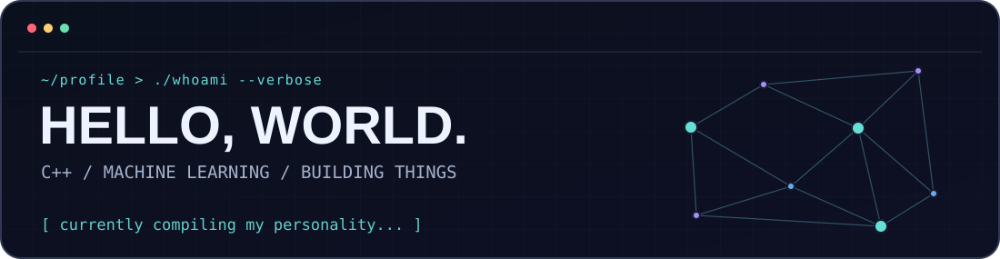
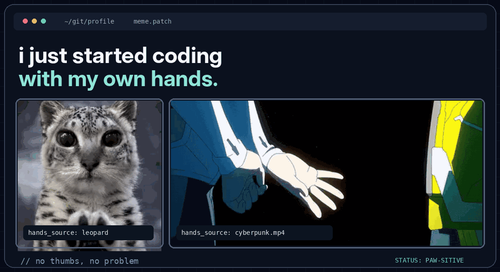
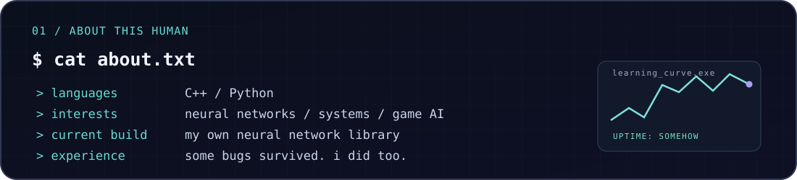
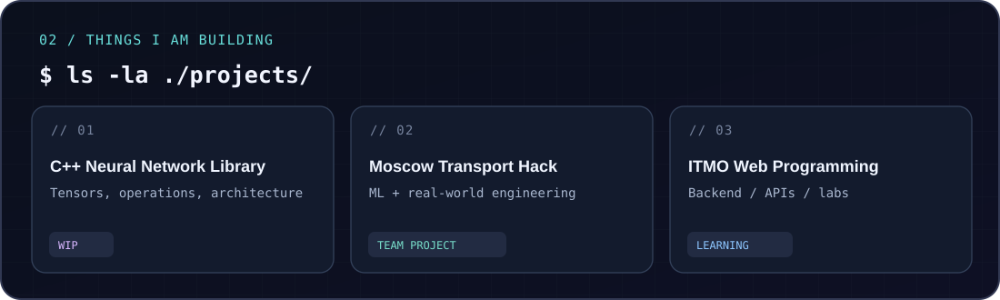
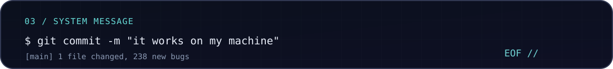

 

 

 

### `> open ./projects`

- **C++ Neural Network Library** - building a neural network library from scratch. *Work in progress.*
- **[Moscow Transport Hack](https://github.com/Chichetin/moscow_transport_hack)** - machine learning, transport data and engineering.
- **[ITMO Web Programming](https://github.com/KirillPetukhov1/ITMO-sem3-WEBprog)** - backend development and university projects.

